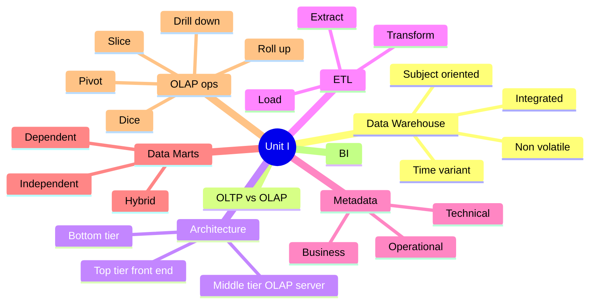
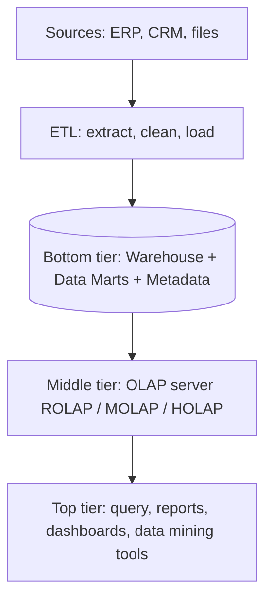
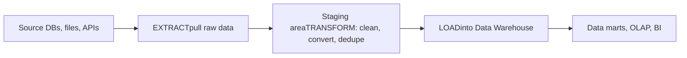
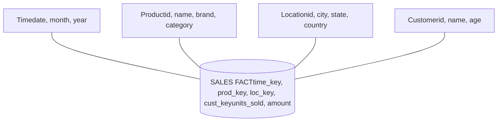
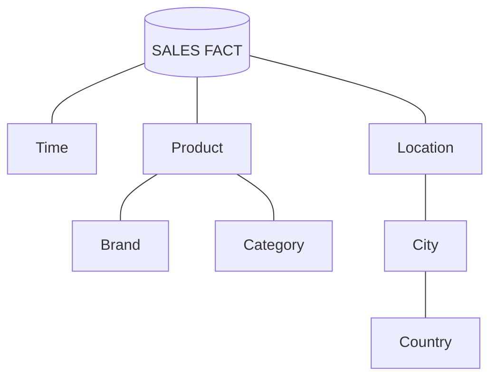
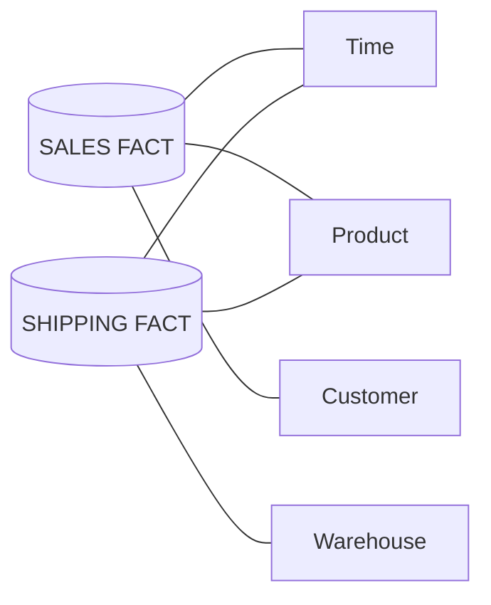
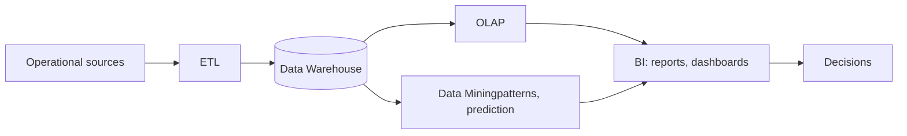
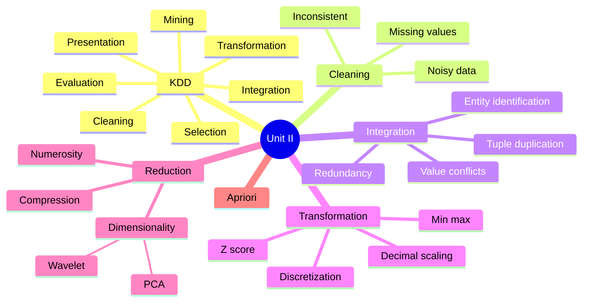
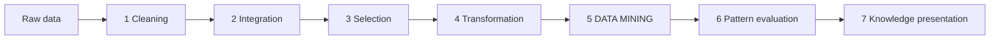
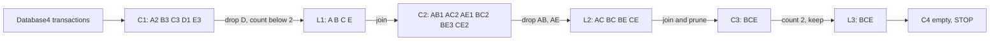

# Data Mining & Warehousing – MTE Quick Notes

Unit I & II · built from the syllabus + question bank · 🟨 = solved problem / exam favourite

## UNIT I – Data Warehousing

### 1. Introduction – Data Warehouse (DW)

A DW is a **subject-oriented, integrated, time-variant, non-volatile** collection of data that supports management's decision making (W. H. Inmon).

- **Subject-oriented:** organised around subjects (Sales, Customer), not applications.
- **Integrated:** data from many sources made consistent (M/F, 1/0 → "Male/Female").
- **Time-variant:** holds history (5–10 yrs); every record has a time key.
- **Non-volatile:** data is loaded and read, never updated/deleted in place.

**Need:** operational DBs are tuned for fast transactions, hold only current data, are scattered across systems – slow and inconsistent for analysis.

### 2. Operational DB (OLTP) vs DW (OLAP) 🟨

| Point | OLTP | Data Warehouse (OLAP) |
| --- | --- | --- |
| Purpose | Day-to-day transactions | Analysis, decision support |
| Data | Current, detailed | Historical, summarised |
| Operations | Insert/update/delete | Mostly read (complex queries) |
| Design | ER model, normalised | Star/snowflake, denormalised |
| Users | Clerks, DBAs (many) | Managers, analysts (few) |
| Size | MB–GB | GB–TB+ |
| Example | ATM withdrawal | Branch-wise yearly deposit trend |

**Retail bank example:** OLTP = deposit, withdraw, balance check. DW = "Which region's loan defaults rose over 5 years?"

### 3. Three-Tier Architecture 🟨

- **Bottom:** warehouse DB server + ETL + metadata repository.
- **Middle:** OLAP server – ROLAP (relational), MOLAP (multidimensional array), HOLAP (hybrid).
- **Top:** front-end tools for users.

### 4. ETL

- **Extract:** pull data from sources (DBs, flat files, APIs).
- **Transform:** clean, deduplicate, convert formats/units, derive fields, aggregate.
- **Load:** write into DW (initial full load, then incremental).

*Eg:* Store A stores date as 12/10/26, Store B as 2026-10-12, currency ₹ and $ → transform to one format & ₹ → load.

### 5. Metadata = "data about data"

- **Technical:** schema, tables, ETL mappings, data types.
- **Business:** business terms, definitions, owners ("Revenue = ...").
- **Operational:** load times, usage logs, data lineage, refresh status.

Functions: guides ETL, query optimisation, data lineage, helps users find data.

### 6. Data Marts

Small, subject/department-specific subset of a DW (Sales mart, HR mart).

- **Dependent:** carved out of the enterprise DW (top-down).
- **Independent:** built directly from sources, no central DW (bottom-up).
- **Hybrid:** mix of DW + operational/external sources.

| DW | Data Mart |
| --- | --- |
| Enterprise-wide, many subjects | One department/subject |
| Large (TB), slow to build | Small (GB), quick, cheaper |

DW pros: single source of truth, history, fast analytics. Cons: costly, ETL complexity, data latency.

### 7. Modeling: Fact, Dimension, Grain, Schemas 🟨

- **Fact table:** numeric *measures* + foreign keys (Sales(date_key, product_key, units, amount)).
- **Dimension table:** descriptive attributes (Product, Time, Location).
- **Grain:** level of detail of one fact row (e.g. one sale per product per store per day).

| Schema | Structure | + / − |
| --- | --- | --- |
| Star | 1 fact in centre, denormalised dimensions | Simple, fast joins / redundancy |
| Snowflake | Dimensions normalised into sub-tables | Less space / more joins, slower |
| Fact constellation | Multiple facts share dimensions | Models many processes / complex |

**Star schema** – one central fact table, dimensions directly attached:

**Snowflake schema** – dimensions normalised into sub-dimensions:

**Fact constellation (galaxy)** – multiple fact tables sharing dimensions:

### 8. OLAP Operations (on a Sales cube: Time × Product × Location) 🟨

- **Roll-up:** go up hierarchy/reduce dimension (city → country; month → year).
- **Drill-down:** reverse – more detail (year → quarter → month).
- **Slice:** fix ONE dimension (Time = Q1) → sub-cube.
- **Dice:** select on TWO+ dimensions (Q1–Q2 AND Delhi, Mumbai AND Mobiles).
- **Pivot (rotate):** swap axes to view data differently.

### 9. Business Intelligence (BI)

Technologies to turn raw data into actionable insight. **Flow:** Sources → ETL → DW → OLAP → Reports/Dashboards → Decisions (Data Mining adds pattern discovery on the DW).

**Components:** DW, ETL, OLAP, reporting/dashboards, data mining. **Uses:** sales forecasting, churn analysis, fraud detection, inventory planning (Power BI, Tableau).

## UNIT II – Preprocessing & Association Mining

### 1. KDD Process 🟨

Steps: **Data cleaning → Integration → Selection → Transformation → Data mining → Pattern evaluation → Knowledge presentation.**

**KDD vs Data Mining:** KDD is the whole end-to-end process; data mining is just *one step* (applying algorithms to extract patterns).

### 2. Data Cleaning 🟨

**Missing values:** ignore tuple · fill manually · global constant ("Unknown") · attribute mean/median · class-wise mean · most probable value (regression/decision tree).

**Noisy data:** **binning** (sort, partition, smooth), **regression** (fit a function), **clustering** (outliers fall outside clusters).

**Problem – Binning.** Data (sorted): 4, 8, 15, 21, 21, 24, 25, 28, 34. Equal-depth bins of 3:\
Bin1 (4, 8, 15) · Bin2 (21, 21, 24) · Bin3 (25, 28, 34)\
**By means:** 9,9,9 | 22,22,22 | 29,29,29\
**By boundaries** (replace by closer of min/max): 4,4,15 | 21,21,24 | 25,25,34\
*Types:* equal-width (same range) vs equal-depth (same count).

**Cleaning as a process:** *Discrepancy detection* (use metadata – domain, range; statistics – mean, σ, outliers; inconsistent codes e.g. "2026/10/12" vs "12-Oct-26") → *Data correction* using transformation tools (ETL, migration) and iterate.

### 3. Data Integration 🟨

- **Entity identification:** same entity, different names – `cust_id` vs `customer_no`; use metadata.
- **Redundancy:** derived/duplicate attribute (age vs DOB); detect by correlation.
- **Tuple duplication:** same record twice (two rows for the same customer).
- **Value conflicts:** weight in kg vs lb; ₹ vs $; different scales.

**Pearson's r** (numeric) = Σ(a−Ā)(b−B̄) / (n·σA·σB). r > 0 → positively correlated (A↑ B↑); r = 0 → independent (no linear relation); r \< 0 → negative. High |r| → one attribute is redundant.

**Problem – Chi-square (nominal).** 1500 people; observed counts (expected in brackets):

|  | Likes sci-fi | Not sci-fi | Total |
| --- | --- | --- | --- |
| Plays chess | 250 (90) | 200 (360) | 450 |
| Not chess | 50 (210) | 1000 (840) | 1050 |
| Total | 300 | 1200 | 1500 |

Expected = (row total × col total)/n, e.g. 450×300/1500 = 90.\
χ² = Σ(O−E)²/E = 284.44 + 71.11 + 121.90 + 30.48 = **507.93**. df = (2−1)(2−1) = 1; critical value at 0.001 = 10.83. Since 507.93 ≫ 10.83 → reject independence: attributes are **strongly correlated**.

### 4. Data Transformation 🟨

Smoothing, aggregation, generalization, **normalization**, attribute construction, discretization.

**Problem – Normalize marks 20, 40, 60, 80, 100.** min = 20, max = 100, mean = 60, σ (population) = √800 ≈ 28.28\
**Min-Max** v' = (v−min)/(max−min): 0, 0.25, 0.5, 0.75, 1\
**Z-score** v' = (v−mean)/σ: −1.41, −0.71, 0, 0.71, 1.41\
**Decimal scaling** v' = v/10j, smallest j with max|v'| \< 1 → j = 3: 0.02, 0.04, 0.06, 0.08, 0.10\
*Result:* min-max fits range \[0,1\], z-score centres on 0 (good with outliers), decimal scaling just moves the decimal point.

**Discretization:** numeric → intervals/labels (age 0–18 "Young", 19–60 "Adult"). **Concept hierarchy:** low→high level: street \< city \< state \< country (nominal); for numeric: binning, histogram, clustering.

### 5. Data Reduction – strategies 🟨

- **Dimensionality reduction** – fewer attributes: **Wavelet transform, PCA**, attribute subset selection.
- **Numerosity reduction** – smaller data representation. *Parametric:* regression, log-linear models (store parameters only). *Non-parametric:* histograms, clustering, sampling, data-cube aggregation.
- **Data compression** – *Lossless* (original fully recovered, e.g. ZIP, run-length) vs *Lossy* (approximate, e.g. JPEG, wavelet/PCA).

**Wavelet transform (DWT):** transforms data vector into wavelet coefficients; keep only the strongest coefficients, set the rest to 0 → compact, de-noised, can reconstruct approximately. Eg. Haar pair (2, 4) → average 3, detail −1. Works well on high-dim, sparse/skewed data.

**PCA steps:**

1. Normalize data.
2. Compute covariance matrix.
3. Find eigenvectors & eigenvalues.
4. Sort by eigenvalue (variance), descending.
5. Keep top k components.
6. Project data onto them.

*Eg:* 10 correlated features (height, weight, BMI…) → 2 principal components capturing \~90% variance. Uses: image compression, noise removal, visualization.

### 6. Apriori Algorithm 🟨 (most-asked problem)

Finds frequent itemsets by level-wise search: L(k) → join → C(k+1) → prune → scan DB → L(k+1).\
**Pruning principle:** *every subset of a frequent itemset must be frequent* (equivalently, any superset of an infrequent itemset is infrequent) – so such candidates are discarded without counting.

**Problem.** Transactions: T10 {A,C,D}, T20 {B,C,E}, T30 {A,B,C,E}, T40 {B,E}. Min support count = 2.\
\
**C1:** A:2, B:3, C:3, D:1, E:3 → **L1** = {A, B, C, E} (D dropped)\
**C2** (join L1): AB:1, AC:2, AE:1, BC:2, BE:3, CE:2 → **L2** = {AC, BC, BE, CE}\
**C3:** join L2 pairs sharing first item → BC+BE = BCE (subsets BC, BE, CE all in L2, so not pruned). Others (e.g. ABC, ACE) pruned since AB / AE are infrequent. BCE appears in T20, T30 → count 2 → **L3** = {BCE}.\
C4 = empty → stop. **Frequent itemsets:** A, B, C, E, AC, BC, BE, CE, BCE.\
*Rule example:* {B,C} → E, confidence = sup(BCE)/sup(BC) = 2/2 = 100%.

## Last-minute exam tips

- 6-markers: definition (1) + points/diagram (3–4) + example (1).
- Always draw: 3-tier architecture, star schema, KDD flow.
- Numericals to practise: binning, chi-square, normalization, Apriori.