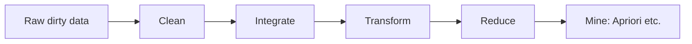
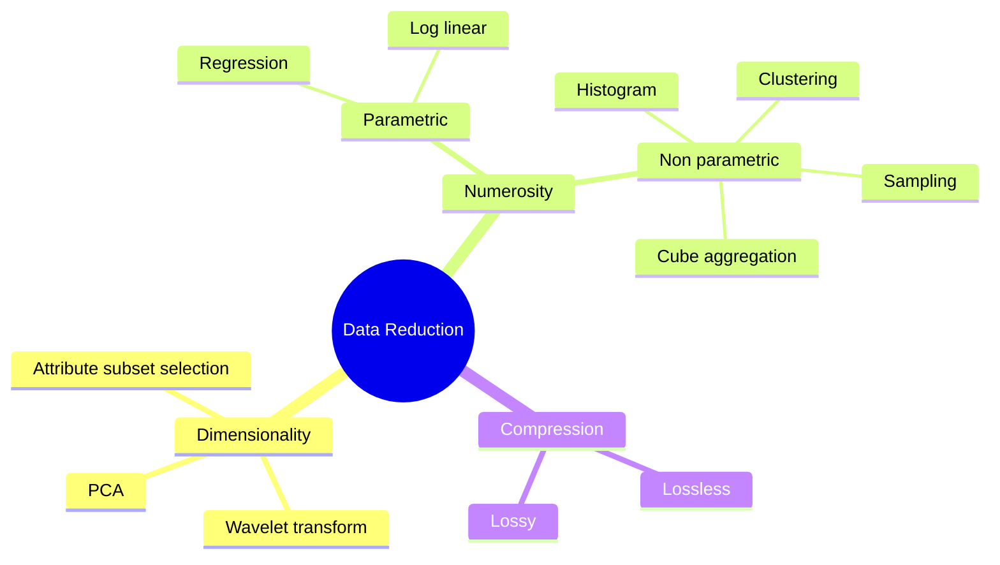
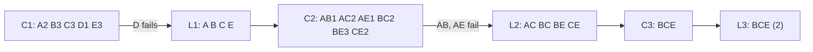

# Unit II – Preprocessing & Association Mining

Idea first, then exam answers. Tags like **\[2M-5\]** / **\[6M-12\]** = question numbers in your bank.

## 0. Big picture – why preprocessing?

Real data is **dirty** (missing, noisy, inconsistent), **scattered** (many sources), **huge** and on **different scales**. Mining on it gives garbage ("garbage in, garbage out"). So each problem has a fix:

| Problem | Fix | Section |
| --- | --- | --- |
| Missing / noisy / inconsistent | Cleaning | 2 |
| Many sources, duplicates | Integration | 3 |
| Different scales / formats | Transformation | 4 |
| Too big | Reduction | 5 |
| Find buying patterns | Apriori | 6 |

## 1. KDD Process \[2M-1,2 · 6M-1\]

**KDD** = non-trivial extraction of valid, novel, useful, understandable patterns from large data.

1. **Cleaning** – remove noise, fix missing values.
2. **Integration** – combine multiple sources.
3. **Selection** – pick data relevant to the task.
4. **Transformation** – normalize/aggregate into mining-ready form.
5. **Data mining** – apply algorithms (classification, clustering, association) to find patterns.
6. **Pattern evaluation** – keep only interesting patterns (support, confidence).
7. **Knowledge presentation** – charts, rules, reports.

**KDD vs Data Mining:** KDD = whole 7-step process (iterative); data mining = only step 5.

**Example:** Supermarket – clean billing data → merge store + loyalty-card data → select last-year sales → normalize → mine "bread ⇒ butter" → keep rules with high confidence → show to manager.

## 2. Data Cleaning \[2M-3,4,5 · 6M-2,3\]

### (a) Missing values – methods

- Ignore the tuple (only if few missing; wasteful).
- Fill manually (costly).
- Global constant ("Unknown").
- Attribute mean/median (median if skewed).
- Class-wise mean (mean of same class, e.g. same income group).
- Most probable value via regression / decision tree (best).

### (b) Noisy data = random error or outlier (age = −5, salary typo)

- **Binning:** sort → partition into bins → smooth using bin means / medians / boundaries. Local smoothing.
- **Regression:** fit a line/curve; replace values by predicted ones.
- **Clustering:** values outside all clusters are outliers.

**Problem \[2M-5\].** Sorted: 4, 8, 15, 21, 21, 24, 25, 28, 34 → equal-depth (3 per bin): (4,8,15) (21,21,24) (25,28,34).\
Means: 9,9,9 | 22,22,22 | 29,29,29 · Boundaries: 4,4,15 | 21,21,24 | 25,25,34.\
Equal-**width** bins use equal range (e.g. width 10: 0–10, 11–20…), equal-**depth** bins hold equal number of values.

### (c) Inconsistent data & cleaning as a process \[6M-3\]

**Step 1 Discrepancy detection:** use *metadata* (data type, range, domain), *statistics* (mean, σ, flag values beyond ±3σ), *inconsistent representations* ("M"/"Male", 12/10/26 vs 2026-10-12), unique/null rules.\
**Step 2 Data correction:** use ETL / migration tools to transform, re-run detection; iterate until clean.

## 3. Data Integration \[2M-6,7,8,9 · 6M-4,5\]

Merging data from multiple sources into one coherent store. **Issues:**

- **Entity identification:** same entity, different names/ids (`cust_id` vs `customer_no`); match using metadata.
- **Redundancy:** attribute derivable from another (age vs DOB; annual vs monthly revenue) – detect with correlation.
- **Tuple duplication:** same record twice (e.g. "Ravi Kumar" and "R. Kumar", same address).
- **Data value conflicts:** same attribute, different units/scales (kg vs lb, ₹ vs $, 0–10 vs 0–100 grades).

**Pearson r (numeric)** = Σ(a−Ā)(b−B̄) / (n·σA·σB), range −1 to +1. **rA,B > 0:** positively correlated (A↑ ⇒ B↑); large value ⇒ one attribute redundant. r = 0: no linear correlation. r \< 0: negative.

**Problem – Chi-square (nominal) \[6M-5\].** χ² = Σ (Observed − Expected)² / Expected, Expected = (row total × column total)/n.

|  | Likes sci-fi | Not | Total |
| --- | --- | --- | --- |
| Plays chess | 250 (90) | 200 (360) | 450 |
| Not chess | 50 (210) | 1000 (840) | 1050 |
| Total | 300 | 1200 | 1500 |

χ² = 160²/90 + 160²/360 + 160²/210 + 160²/840 = 284.44 + 71.11 + 121.90 + 30.48 = **507.93**. df = (r−1)(c−1) = 1; critical value (0.001) = 10.83. 507.93 > 10.83 ⇒ reject "independent" ⇒ attributes are strongly correlated (one may be redundant).

## 4. Data Transformation \[2M-13,14 · 6M-10,11\]

Methods: smoothing, aggregation, generalization, **normalization**, attribute construction, **discretization**.

**Problem \[6M-11\].** Marks 20, 40, 60, 80, 100: min 20, max 100, mean 60, σ = √((1600+400+0+400+1600)/5) = √800 ≈ 28.28.\
**Min-Max** (v−20)/80 → 0, 0.25, 0.5, 0.75, 1 | **Z-score** (v−60)/28.28 → −1.41, −0.71, 0, 0.71, 1.41 | **Decimal scaling** v/10j, j = 3 (since 100/10² = 1 is not \< 1) → 0.02, 0.04, 0.06, 0.08, 0.10.\
*Explain:* min-max keeps relationships but sensitive to outliers; z-score (mean 0) handles outliers better; decimal scaling just shifts the point.

**Discretization:** replace continuous values with intervals/labels. *Eg:* age 23 → "20–30" → "Young". Methods: binning, histogram, clustering (unsupervised); entropy-based (supervised).

**Concept hierarchy generation:** replace low-level by higher-level concepts. *Nominal:* street \< city \< state \< country (use attribute ordering; attribute with most distinct values sits lowest). *Numerical:* age 0–100 → (0–20)(21–60)(60+) → Young/Adult/Senior using binning or histogram analysis.

## 5. Data Reduction \[2M-10,11,12 · 6M-6,7,8,9\]

**Goal:** smaller data, almost same analytical result.

### Dimensionality reduction (fewer attributes)

**Wavelet (DWT):** data → wavelet coefficients; store only strongest coefficients, zero the rest → compact, removes noise, approximate reconstruction. *Eg:* Haar on (2,4): average 3, detail −1.\
**PCA:** find new orthogonal axes (principal components) ordered by variance; keep first k.

**PCA steps:** 1 Normalize → 2 Covariance matrix → 3 Eigenvalues & eigenvectors → 4 Sort by eigenvalue (desc) → 5 Keep top k → 6 Project data. Uses: compression, noise removal, visualization, speeding up ML.

**Mini PCA example.** Points (2,1) (3,2) (4,3) (5,4). Mean (3.5, 2.5) → centred (−1.5,−1.5) (−0.5,−0.5) (0.5,0.5) (1.5,1.5).\
Covariance = \[\[1.67, 1.67\],\[1.67, 1.67\]\] → eigenvalues 3.33 and 0; PC1 = (0.71, 0.71) explains 100% variance.\
Projection onto PC1: −2.12, −0.71, 0.71, 2.12 ⇒ 2-D reduced to 1-D with no loss.

### Numerosity reduction (replace data by smaller representation)

- **Parametric** – store model parameters, drop data: *regression* (y = wx + b), *log-linear* (approximates multidimensional probability from lower-dim combinations).
- **Non-parametric:** *Histogram* (equal-width / equal-frequency buckets) · *Clustering* (store cluster centroids) · *Sampling* (SRSWOR, SRSWR, cluster, stratified) · *Data cube aggregation* (quarterly sales instead of daily).

### Data compression

**Lossless:** original fully recovered (ZIP, run-length, Huffman). **Lossy:** only approximation (JPEG, MP3, wavelet/PCA) – higher compression.

## 6. Apriori Algorithm \[6M-12\]

**Terms:** support = occurrence count (or %) of itemset; frequent = support ≥ min_sup; confidence(A⇒B) = sup(A∪B)/sup(A).\
**Procedure:** scan DB → C1 → keep frequent L1 → join Lk → C(k+1) → **prune** → scan → L(k+1) … until none.\
**Pruning principle (Apriori property):** all non-empty subsets of a frequent itemset must be frequent; so if any subset is infrequent, drop the candidate without counting.

**Problem.** T10 {A,C,D}, T20 {B,C,E}, T30 {A,B,C,E}, T40 {B,E}; min sup = 2.\
**C1:** A2 B3 C3 D1 E3 → **L1:** A, B, C, E\
**C2:** AB1 AC2 AE1 BC2 BE3 CE2 → **L2:** AC, BC, BE, CE\
**C3:** join gives BCE (BC+BE). Subsets BC, BE, CE ∈ L2 ✓. ABC/ACE never form (AB, AE ∉ L2) → pruned. BCE count 2 (T20, T30) → **L3:** BCE. C4 = ∅ → stop.\
**Rule:** B∧C ⇒ E, confidence = 2/2 = 100%.

## 7. 2-mark quick answers

| 1 | KDD = process of discovering valid, novel, useful patterns from large databases. |
| --- | --- |
| 2 | KDD = full process; data mining = one step (pattern discovery) within it. |
| 3 | Noisy data = random error/outlier in a value, e.g. age = −5 or salary 99,99,999. |
| 4 | Missing values: fill with attribute mean; ignore tuple (also constant, most probable value). |
| 5 | Binning smooths sorted data using neighbours. Types: equal-width, equal-depth. e.g. (4,8,15) → mean 9. |
| 6 | Data integration = combining data from multiple sources into one consistent store. |
| 7 | Entity identification = matching same real entity across sources (cust_id ≡ customer_no). |
| 8 | Tuple duplication = same record appearing twice, e.g. "Ravi Kumar" and "R. Kumar" at same address. |
| 9 | Pearson r measures linear correlation (−1 to +1); rA,B > 0 means A and B increase together. |
| 10 | Dimensionality reduction = reducing number of attributes; techniques: PCA, wavelet transform. |
| 11 | PCA projects data onto few orthogonal axes of maximum variance, to reduce dimensions. |
| 12 | Numerosity reduction = replace data by smaller form, e.g. sampling or histogram. |
| 13 | Discretization = continuous values → intervals/labels, e.g. age 23 → "20–30". |
| 14 | Concept hierarchy = low→high level mapping, e.g. street \< city \< state \< country. |

## Exam strategy

- Always do these numericals fully: **binning, chi-square, normalization, Apriori** (4–5 marks are for the steps).
- 6-markers: definition → points/steps → example. Draw the KDD flow and Apriori table.